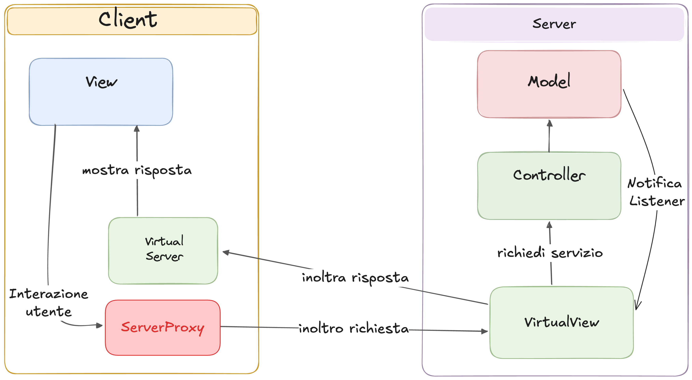
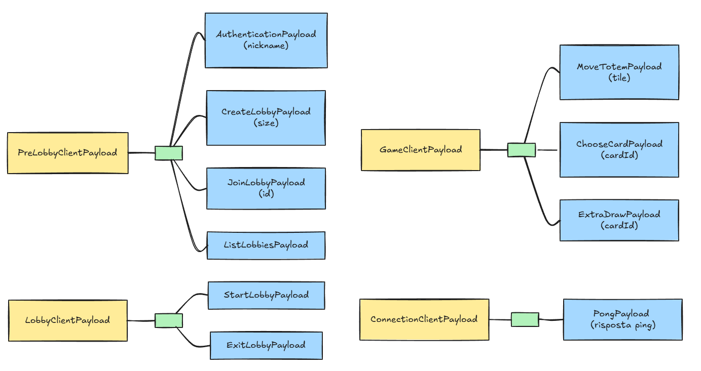
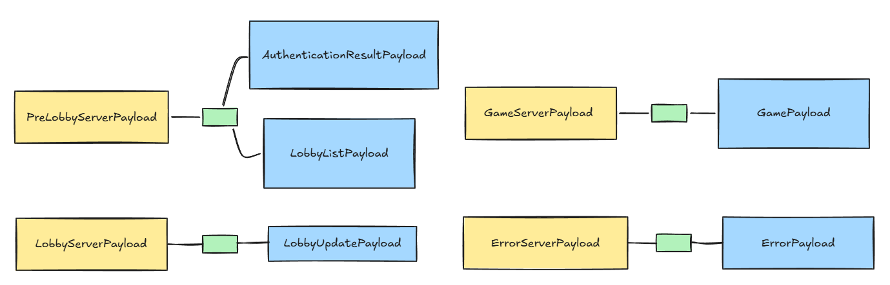
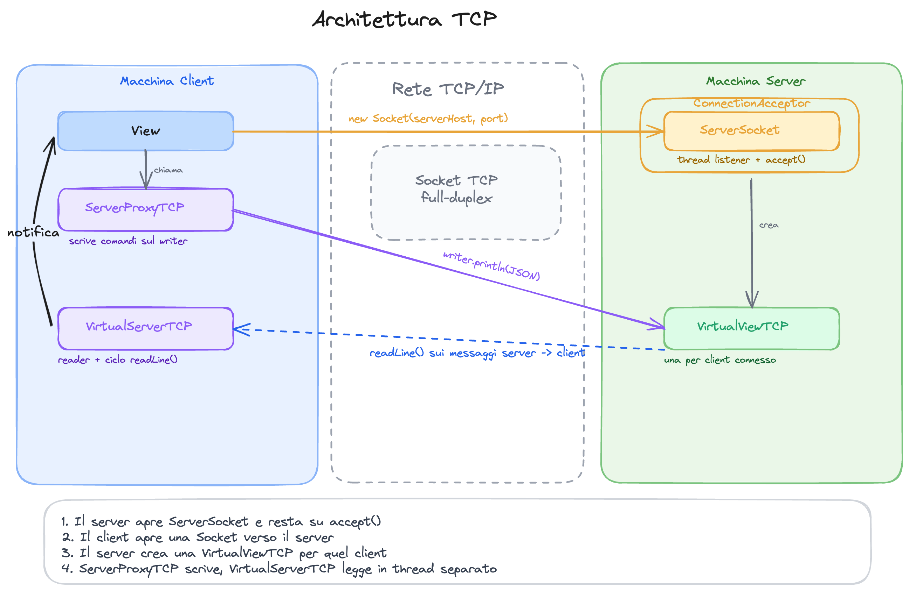
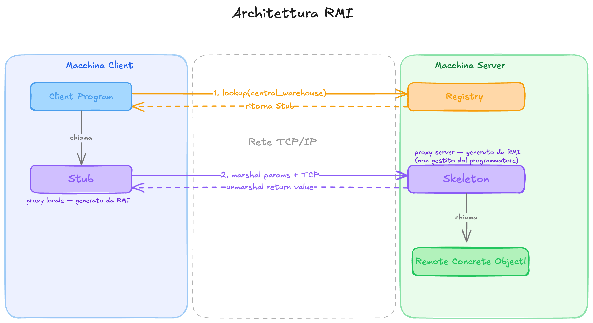
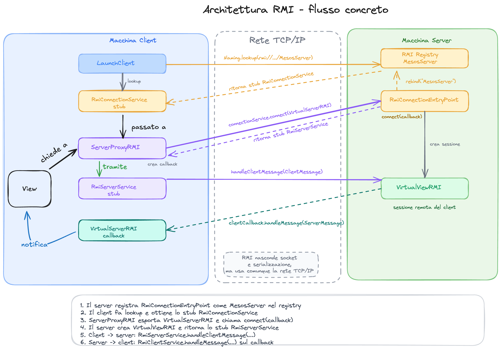
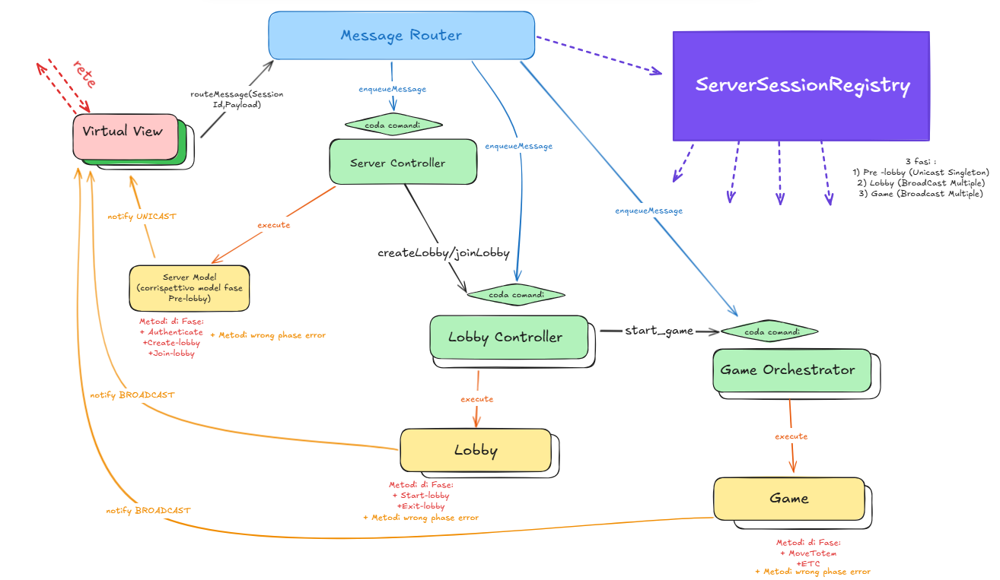

# Mesos

Questo repository contiene l’implementazione Java del gioco da tavolo **Mesos**, sviluppata come prova finale del progetto di Ingegneria del Software 2025-2026 al Politecnico di Milano.

Il progetto è stato svolto dal gruppo GC3, composto dai seguenti membri:
- Vaccari Tommaso
- Viggiano Luca
- Zanatta Tommaso
- Zorloni Fabio


L’applicazione è stata progettata come sistema distribuito client-server secondo il pattern Model-View-Controller.
Il server mantiene il modello di gioco, gestisce la logica applicativa e coordina le partite;
i client permettono ai giocatori di interagire con il gioco attraverso interfaccia testuale
o interfaccia grafica JavaFX.

## Requisiti implementati

Rispetto alla tabella di valutazione fornita insieme alla specifica, il progetto implementa:

**Regole Complete + TUI + GUI + RMI + Socket + 2 Funzionalità Avanzate**

In particolare sono stati implementati:

- **Regole Complete**: il gioco supporta le regole complete di Mesos (non quelle avanzate).
- **TUI**: il client può essere avviato con interfaccia testuale.
- **GUI**: il client può essere avviato con interfaccia grafica JavaFX.
- **Socket TCP**: client e server possono comunicare tramite protocollo TCP.
- **Java RMI**: client e server possono comunicare tramite Java Remote Method Invocation.
- **Funzionalità Avanzata — Partite multiple**: il server può gestire più partite contemporaneamente.
- **Funzionalità Avanzata — Resilienza alle disconnessioni**: un client disconnesso può riconnettersi e
continuare la partita. Se un player si disconnette il suo turno viene saltato. Se rimane un solo player connesso
parte un timer, al termine del quale l'unico giocatore rimasto connesso viene decretato vincitore.


## Configurazione, Compilazione e Avvio

In questa sezione viene spiegato come configurare la rete, e poi come avviare server e client usando
i JAR già compilati presenti nella cartella `deliverables/jar`.

### 1. Recuperare gli indirizzi IP locali
Se server e client vengono eseguiti sulla stessa macchina, si può usare `localhost`.
Se invece si vuole giocare in rete locale, ad esempio con più computer collegati alla stessa rete Wi-Fi
o allo stesso hotspot, bisogna recuperare:
- l'indirizzo IP della macchina su cui viene avviato il server
- l'indirizzo IP della macchina su cui viene avviato il client, necessario solo se si sceglie RMI

Di seguito i comandi per recuperare l'indirizzo IP locale a seconda del sistema operativo:

* **macOS**:
  ```bash
  ipconfig getifaddr en0
  ```
  Se si è connessi con un'interfaccia diversa dal Wi-Fi, verificare l'indirizzo con `ifconfig`.
* **Linux**:
  ```bash
  ip route get 1.1.1.1 | awk '{print $7}'
  ```
  In alternativa, eseguire `ip a` o `hostname -I`.
* **Windows**:
  ```cmd
  ipconfig
  ```
  Cercare la voce `Indirizzo IPv4`, ad esempio `192.168.1.56`.


### 2. Permessi firewall
Se server e client non sono sulla stessa macchina, il sistema operativo può bloccare le connessioni anche
quando IP e porte sono corretti.

Sulla macchina che esegue il server bisogna permettere a Java di ricevere connessioni in entrata e di usare
connessioni in uscita. A seconda di come viene avviato il progetto, il programma da autorizzare può comparire
come `java`, `javaw`, `JavaVM` oppure `IntelliJ IDEA`.

Questo vale su macOS, Windows e Linux:
- il server deve poter accettare connessioni TCP sulla porta TCP scelta a runtime;
- il server deve poter pubblicare e servire RMI sulla porta RMI scelta a runtime;
- con RMI, anche il client deve poter ricevere la callback del server, quindi può essere necessario autorizzare
  Java o IntelliJ anche sulla macchina client.

Se il firewall chiede se consentire l'accesso alla rete, bisogna permetterlo almeno per la rete locale usata
per giocare. In caso contrario il client può non riuscire a connettersi, oppure RMI può collegarsi ma non
riuscire a consegnare le risposte.

### 3. Avvio interattivo da terminale
La configurazione di rete viene chiesta interamente a runtime tramite prompt interattivi: il codice
non legge argomenti posizionali passati al `main`, né proprietà Java (`-D...`), né file `.env`. La
sola fonte di verità sono le risposte inserite a terminale all'avvio.

Per avviare basta lanciare il JAR e rispondere alle domande. Il server avvia sempre sia TCP che RMI;
il client chiede anche quale interfaccia (GUI/TUI) e quale protocollo di rete (TCP/RMI) usare.

#### Server
```bash
java -jar deliverables/jar/mesos-server.jar
```

All'avvio il server chiede (tra parentesi i valori di esempio):

```text
Enter MESOS_TCP_PORT: 12345
Enter MESOS_RMI_PORT: 1099
Enter MESOS_SERVER_RMI_HOST (optional, press Enter to skip): 192.168.1.56
```

- `MESOS_TCP_PORT` è la porta usata per TCP.
- `MESOS_RMI_PORT` è la porta usata dal registry RMI.
- `MESOS_SERVER_RMI_HOST` è l'indirizzo che RMI inserisce nello stub del server: se si gioca in
  locale si può lasciare vuoto premendo Invio, se invece i client sono su altre macchine va inserito
  l'IP locale del server.

#### Client
Per il client bisogna usare il JAR adatto al sistema operativo:
- `mesos-client-mac-aarch64.jar` per macOS Apple Silicon
- `mesos-client-mac-x64.jar` per macOS Intel
- `mesos-client-linux-x64.jar` per Linux x64
- `mesos-client-windows-x64.jar` per Windows x64

```bash
java -jar deliverables/jar/mesos-client-mac-aarch64.jar
```

All'avvio il client chiede (tra parentesi i valori di esempio):

```text
Enter MESOS_SERVER_HOST: 192.168.1.56
Enter MESOS_TCP_PORT: 12345
Enter MESOS_RMI_PORT: 1099
Enter MESOS_CLIENT_RMI_HOST (optional, press Enter to skip): 192.168.1.74
Select UI mode:
1) GUI
2) TUI
Select network technology:
1) TCP
2) RMI
```

- `MESOS_SERVER_HOST` è l'indirizzo della macchina su cui gira il server.
- `MESOS_CLIENT_RMI_HOST` serve solo per RMI, perché in quel caso anche il server deve poter
  richiamare il client tramite callback; se si sceglie TCP si può lasciare vuoto premendo Invio.

Ad esempio, con il server su IP `192.168.1.56` e il client su IP `192.168.1.74`, al server si
risponde `12345`, `1099` e `192.168.1.56`; al client `192.168.1.56`, `12345`, `1099` e
`192.168.1.74`, scegliendo poi interfaccia e protocollo.

### Compilazione e Creazione dei JAR
Il progetto è gestito tramite Maven, usato per compilare il codice, eseguire i test e gestire le dipendenze.

Per compilare il progetto ed eseguire i test:
```
./mvnw clean test
```

Per generare i FAT JAR finali:
```
./assets/scripts/create-jar.sh
```

Lo script crea i JAR nella cartella: deliverables/jar

---

## Architettura del progetto
In questa sezione viene spiegata l'architettura ad alto livello del progetto, poi nelle relative
sottosezioni verranno spiegati in dettaglio i pattern applicati e i dettagli implementativi.

Il design pattern principale del progetto è quello del [Model View Controller distribuito](https://github.com/T-vaccari/javafx-distributed-mvc),
ovvero una versione del MVC in cui la View si trova su un'altra macchina rispetto al Controller
e al Model.

Ricordiamo che il pattern MVC classico è un pattern architetturale che separa il modello dei dati
di un'applicazione (model) dalla rappresentazione grafica (view) e dalla logica di controllo (controller).
L'idea è quella di avere la View che si occupa della logica di presentazione delle informazioni
e di raccogliere input dall'utente, il controller invece si occupa
di coordinare il Model per gestire le richieste dell'utente.
Infine il Model si occupa di mantenere lo stato e la logica
di dominio.
In generale esistono diverse varianti del MVC non distribuito, che hanno alcune differenze su come
la view interagisce con gli altri due componenti. In particolare qui è stata implementata
la versione nella quale
la view viene notificata dal Model a seguito di un update, la view non conosce quindi il Model,
e sotto un certo punto di vista il Model non conosce la view, poiché viene applicato il pattern observer, ovvero il model
ha riferimenti alla view sotto forma di interfacce listener.
Di seguito uno schema illustrato del pattern:


L'utente interagisce con la View, immaginiamo che richieda un servizio, il flusso è il seguente:
1. La view contatta il controller a seguito dell'input utente
2. Il controller fa una prima validazione della richiesta, e sa, in base alla richiesta ricevuta, che cosa
richiedere al model. Qui si può fare una prima distinzione tra controller thin e fat,
a seconda di quanta logica di dominio
viene spostata all'interno del controller. In generale in questa implementazione abbiamo sempre
optato per avere controller thin.
Il controller dopo aver validato la richiesta, richiede il servizio effettivo al model, che di conseguenza
reagisce e aggiorna il suo stato interno.
3. Dopo che il modello ha modificato il proprio stato interno e ha applicato la logica di dominio,
deve notificare le relative virtual view. Possono essercene più di una, dato che più utenti
possono utilizzare lo stesso modello. Nella nostra applicazione del pattern abbiamo scelto
di non permettere al modello di conoscere direttamente le view, ma di avere invece iscritti dei listener,
che poi di fatto sono concretizzati dalle virtual view.

L'idea adesso è quella di prendere il pattern classico ed adattarlo ad un contesto nel quale la
view si trova sulla macchina dell'utente, invece il model ed il controller si trovano sul server.
È quindi necessario aggiungere un layer di rete per il trasporto delle informazioni, nascondendo però
ai blocchi del pattern il fatto che di mezzo ci sia la rete. Ovvero per ottenere un'architettura quanto
più pulita possibile la rete deve essere nascosta, non deve essere parte integrante di questo modello.
Per nascondere la presenza della rete sono stati introdotti contratti comuni, che rappresentano
localmente gli oggetti remoti con cui ciascun lato deve interagire.
Sul client, la user interface non comunica direttamente con la rete, ma usa un `ServerProxy`,
che rappresenta il server remoto ed espone i servizi applicativi richiedibili dal client.
In questo senso è stato applicato il remote proxy pattern.
Sempre sul client, il `VirtualServer` rappresenta il canale attraverso cui arrivano
i messaggi dal server verso l'interfaccia utente locale. Espone infatti i servizi che il server può
richiedere sul client.
Sul server, la `VirtualView` rappresenta invece l'interfaccia utente remota del client:
riceve i comandi provenienti dal client e permette al server di notificare aggiornamenti verso quel client.
Espone i servizi che
il client può richiedere al server.
Non è stato introdotto un `ServerProxy` simmetrico lato server, perché il server non deve invocare
una varietà di servizi applicativi sul client. In quel verso della comunicazione è sufficiente la `VirtualView`,
che mantiene il riferimento al client remoto e offre il punto unico attraverso cui inviargli notifiche.

Per chiarire meglio l'architettura può essere utile questo schema illustrato:



## Protocollo di comunicazione

Il progetto adotta un'architettura MVC distribuita: view, controller e model si trovano in processi diversi, quindi alcune interazioni attraversano la rete.
Perché questa separazione non comprometta la pulizia dell'architettura, la rete deve essere trasparente per la logica applicativa: né la view né il model devono sapere se stanno comunicando via TCP o RMI.

Per raggiungere questo obiettivo il sistema introduce due contratti che simulano localmente la presenza della controparte remota — ciascuno finge di essere l'oggetto che il proprio lato vorrebbe avere vicino:

- **`VirtualView`** (risiede sul server): per il model è la view del client.
  Il model la registra come listener tramite l'Observer pattern e chiama `notifyUpdate()` su di essa esattamente come farebbe con una view locale; è la `VirtualView` concreta che si occupa di serializzare e trasportare l'aggiornamento attraverso la rete verso il client reale.

- **`VirtualServer`** (risiede sul client): per la UI è il lato ricevente del server.
  Riceve i messaggi che arrivano dalla rete e li consegna alla view locale, che non sa nulla del trasporto sottostante.

Questi contratti hanno un doppio ruolo: a livello architetturale sono i punti di comunicazione tra client e server; a livello implementativo permettono a TCP e RMI di offrire gli stessi servizi senza che la logica applicativa debba sapere quale protocollo è in uso.

Tuttavia, TCP e RMI hanno vincoli tecnici diversi che impediscono di usare le stesse interfacce in entrambi i casi.
Nel caso TCP le interfacce sono normali interfacce Java.
Nel caso RMI, invece, le interfacce remote devono estendere `Remote` e i loro metodi devono dichiarare `RemoteException`, perché RMI non può garantire che una chiamata remota abbia successo come farebbe una chiamata locale.

Questa differenza introduce nel codice due livelli di contratto:
- **Livello applicativo** — `VirtualView` e `VirtualServer` descrivono i servizi indipendentemente dal protocollo usato
- **Livello RMI** — `RmiServerService` e `RmiClientService` espongono servizi equivalenti con i vincoli tecnici richiesti da RMI

L'allineamento funzionale tra i due livelli è quindi:
- `VirtualView` ↔ `RmiServerService`: comandi client → server
- `VirtualServer` ↔ `RmiClientService`: notifiche server → client

RMI richiede un ulteriore contratto, `RmiConnectionService`, che non ha un corrispondente nel livello applicativo.
Viene usato dal client per aprire la connessione iniziale, ottenere lo stub della propria sessione server-side e passare al server il proprio callback per le notifiche.
È il punto di ingresso di tutta la comunicazione RMI, prima che esistano sessioni individuali per ogni client.

### Messaggi e Payload usati dal protocollo

Nel codice bisogna distinguere tra messaggio e payload.
Il payload contiene i dati applicativi veri e propri: il nickname scelto dal client, l'id della lobby, la carta selezionata, lo stato aggiornato della partita.
Il messaggio è l'envelope che aggiunge le informazioni necessarie a interpretare quel payload.

La forma concreta che hanno questi tipi è dettata principalmente dal problema di TCP.
Sulla socket arriva solo una stringa JSON: il ricevente non sa a priori quale classe concreta di payload ricostruire, perché a livello di contratto il payload è visto solo tramite le interfacce `ClientPayload` o `ServerPayload`.
Per risolvere questo problema ogni messaggio include un campo `type`, che fa da discriminante: il ricevente legge prima il tipo, poi chiede a GSON di deserializzare il payload nella classe concreta corrispondente.

Il wrapper esiste quindi in due varianti, una per ciascuna direzione:
- `ClientMessage`, con un `ClientMessageType` e un payload che implementa `ClientPayload`, per i messaggi client → server
- `ServerMessage`, con un `ServerMessageType` e un payload che implementa `ServerPayload`, per i messaggi server → client

RMI non ha questo problema: gli oggetti vengono passati direttamente tramite invocazione remota, senza serializzazione JSON esplicita.
Tuttavia riutilizza gli stessi payload, così TCP e RMI condividono lo stesso contratto dati a livello applicativo e la logica di dominio non dipende dal protocollo scelto.

I payload sono organizzati gerarchicamente rispetto alla fase di gioco:
- pre-lobby: payload usati nella fase di autenticazione e scoperta delle lobby
- lobby: payload usati nella fase di creazione e gestione della lobby
- in-game: payload usati durante la partita

E rispetto al senso di comunicazione:
- client → server: package `clienttoserver`, radice `ClientPayload`
- server → client: package `servertoclient`, radice `ServerPayload`





Alcuni payload, come `LobbySummaryPayload`, `BoardPayload`, `PlayerPayload`, `CardPayload`, `OfferSpacePayload`, `StartingBlockPayload`, `TribePayload`, `TurnOrderPayload` e `TurnStatePayload`, non vengono inviati direttamente come messaggi principali ma sono payload di supporto annidati dentro payload più grandi, usati per strutturare dati complessi come lo stato della board o il turno corrente.

### Protocollo TCP

TCP è un protocollo di trasporto che si basa su un canale di comunicazione bidirezionale: la socket, identificata univocamente dalla quadrupla `(IP_sorgente, porta_sorgente, IP_destinazione, porta_destinazione)`.
Una volta stabilita la connessione, i due endpoint possono scrivere e leggere dati sullo stesso canale in entrambe le direzioni.

Dal punto di vista dei dati, però, la socket espone uno stream continuo di byte: non esiste un confine naturale tra un messaggio e il successivo.
È quindi responsabilità dell'applicazione definire un protocollo di framing.
Nel progetto la scelta è semplice: ogni messaggio applicativo viene serializzato in JSON e scritto sulla socket come una singola riga di testo.
Dall'altro lato il messaggio viene letto con `readLine()`, quindi una riga corrisponde a un messaggio applicativo completo.

La lettura con `readLine()` è bloccante: il thread rimane sospeso finché non arriva una riga completa o la connessione non si chiude.
Per questo motivo la lettura non può avvenire sul thread principale: sia il server che il client dedicano un thread separato alla ricezione dei messaggi, così il resto dell'applicazione può continuare a operare mentre il thread di lettura è in attesa.

```java
while ((message = reader.readLine()) != null) {
    handleMessage(message);
}
```

La scrittura avviene invece solo quando c'è un comando o una notifica da inviare, quindi non richiede un thread dedicato:

```java
writer.println(serializedMessage);
```

#### Flusso lato server

Sul server viene creato un `ConnectionAcceptor`, che apre la `ServerSocket` sulla porta configurata e gira su un thread dedicato in attesa di nuove connessioni:

```java
ConnectionAcceptor acceptor = new ConnectionAcceptor(tcpPort, serverConnectionLifecycle, router);
Thread acceptorThread = new Thread(acceptor, "mesos-connection-acceptor");
acceptorThread.start();
```

Per ogni client che si connette, il `ConnectionAcceptor` crea una `VirtualViewTCP` dedicata e la avvia su un thread proprio:

```java
Socket clientSocket = this.serverSocket.accept();
VirtualViewTCP virtualView = new VirtualViewTCP(clientSocket, this.serverConnectionLifecycle, this.router);
Thread virtualViewThread = new Thread(virtualView, "mesos-virtual-view-" + clientSocket.getPort());
virtualViewThread.start();
```

Ogni `VirtualViewTCP` è quindi la sessione di un singolo client: gira sul proprio thread, legge i messaggi in arrivo da quel client e può inviare notifiche verso di lui.

#### Flusso lato client

Sul client, `ServerProxyTCP` apre la socket verso il server e prepara il writer per i messaggi in uscita.
Contestualmente avvia un `VirtualServerTCP` su un thread dedicato, che si occupa di restare in ascolto dei messaggi in ingresso dal server:

```java
this.socket = new Socket(serverHost, port);
this.writer = new PrintWriter(this.socket.getOutputStream(), true);
this.virtualServer = new VirtualServerTCP(this.socket, clientView, this);
this.virtualServerThread = new Thread(this.virtualServer, "mesos-client-server-message-receiver");
this.virtualServerThread.start();
```

Dentro `VirtualServerTCP` viene preparato il reader e parte il ciclo di lettura:

```java
BufferedReader reader = new BufferedReader(new InputStreamReader(this.socket.getInputStream()));

while (this.running && (serializedMessage = reader.readLine()) != null) {
    this.handleMessage(serializedMessage);
}
```



In sintesi il flusso concreto TCP è:
- il server avvia il `ConnectionAcceptor` su un thread dedicato
- per ogni client che si connette viene creata una `VirtualViewTCP` su un proprio thread
- il client apre la socket e avvia `VirtualServerTCP` su un thread dedicato alla ricezione
- client → server: `ServerProxyTCP` serializza e scrive sul writer
- server → client: `VirtualViewTCP` serializza e scrive, `VirtualServerTCP` legge e consegna alla view

#### GSON

GSON è la libreria usata per trasformare oggetti Java in stringhe JSON e viceversa.
La serializzazione di un messaggio in uscita è diretta:

```java
ClientMessage message = new ClientMessage(ClientMessageType.AUTHENTICATE, new AuthenticationPayload("tom"));
String serializedMessage = GSON.toJson(message);
```

La deserializzazione in ingresso è più articolata perché il campo `payload` è dichiarato come interfaccia (`ClientPayload` o `ServerPayload`) e GSON non sa quale classe concreta istanziare.
Il `type` fa quindi da discriminante: il messaggio viene prima letto come `JsonObject` per estrarre il tipo, poi il payload viene deserializzato nella classe concreta corrispondente.
Questo processo è visibile nel `ClientCommandHandler` lato server:

```java
JsonObject root = GSON.fromJson(rawMessage, JsonObject.class);
ClientMessageType type = ClientMessageType.valueOf(root.get("type").getAsString());
JsonElement payloadElement = root.get("payload");

ClientPayload payload = switch (type) {
    case AUTHENTICATE -> GSON.fromJson(payloadElement, AuthenticationPayload.class);
    case CREATE_LOBBY  -> GSON.fromJson(payloadElement, CreateLobbyPayload.class);
    case MOVE_TOTEM   -> GSON.fromJson(payloadElement, MoveTotemPayload.class);
    // altri type mappati sulle rispettive classi di payload
};
```

### Protocollo RMI

RMI è un'astrazione Java per la comunicazione distribuita: permette a una JVM di invocare metodi su oggetti che risiedono in un'altra JVM, con la stessa sintassi di una chiamata locale.
A differenza di TCP, il codice applicativo non apre socket, non serializza righe JSON e non mantiene cicli di `readLine()`: questi aspetti restano presenti a livello di trasporto ma sono nascosti dal meccanismo degli stub e delle interfacce remote.

La differenza architetturale rispetto a TCP riguarda soprattutto la direzione server → client.
In TCP il server può scrivere al client in qualsiasi momento perché lo stream bidirezionale è sempre aperto.
In RMI non esiste uno stream: tutto è invocazione di metodi su oggetti remoti.
Per notificare il client, il server ha bisogno di qualcosa da poter chiamare: per questo il client deve esportare un oggetto remoto — il callback — e passarlo al server durante la connessione.



#### Connessione

Il server pubblica nel registry RMI un oggetto di tipo `RmiConnectionEntryPoint`, che implementa `RmiConnectionService` e viene registrato con il nome `MesosServer`.
Il registry funge da name service: permette al client di scoprire l'entry point del server senza dover conoscere lo stub direttamente.

```java
RmiConnectionService rmiEntryPoint = new RmiConnectionEntryPoint(controller, router);
LocateRegistry.createRegistry(port);
Registry registry = LocateRegistry.getRegistry(port);
registry.rebind("MesosServer", rmiEntryPoint);
```

Il client ottiene lo stub dell'entry point tramite lookup:

```java
String registryUrl = "rmi://" + serverHost + ":" + rmiPort + "/MesosServer";
RmiConnectionService connectionService =
        (RmiConnectionService) Naming.lookup(registryUrl);
```

Prima di chiamare `connect(...)`, il client esporta il proprio callback RMI, `VirtualServerRMI`: è l'oggetto remoto che il server chiamerà per consegnare notifiche al client.

```java
this.callbackReceiver = new VirtualServerRMI(clientView, exportCallback);
this.serverStub = connectionService.connect(this.callbackReceiver);
this.callbackReceiver.attachServerProxy(this);
```

La chiamata a `connect(...)` arriva sul server in `RmiConnectionEntryPoint`, che riceve il callback e crea una `VirtualViewRMI` dedicata a quella sessione:

```java
public RmiServerService connect(RmiClientService clientCallback) throws RemoteException {
    return new VirtualViewRMI(this.serverConnectionLifecycle, clientCallback, this.router);
}
```

`VirtualViewRMI` è la sessione remota del singolo client lato server: registra la connessione e conserva il callback ricevuto.

```java
this.clientCallback = clientCallback;
this.sessionId = this.serverConnectionLifecycle.registerConnection(this);
```

Il valore restituito da `connect(...)` è uno stub di tipo `RmiServerService`, che il client userà d'ora in poi per inviare comandi — senza più passare dal registry.

#### Scambio messaggi

Client → server: `ServerProxyRMI` invoca un metodo sullo stub `RmiServerService`, la chiamata arriva in `VirtualViewRMI.handleClientMessage(...)`.
Il messaggio viene ricevuto come oggetto Java e inoltrato direttamente al router applicativo:

```java
this.serverStub.handleClientMessage(message);
```

```java
ClientPayload payload = clientMessage.payload;
this.router.routeMessage(this.sessionId, payload);
```

Server → client: il model notifica `VirtualViewRMI` tramite l'Observer pattern.
`VirtualViewRMI` invoca il metodo sul callback remoto del client:

```java
this.clientCallback.handleMessage(
        new ServerMessage(ServerMessageType.AUTHENTICATION_RESULT, authenticationResultPayload)
);
```

La chiamata arriva in `VirtualServerRMI.handleMessage(...)`, che la inoltra al `MessageRouter` della UI:

```java
this.messageRouter.routeMessage(message);
```



In sintesi il flusso concreto RMI è:
- il server registra `RmiConnectionEntryPoint` nel registry come `MesosServer`
- il client fa lookup e ottiene lo stub `RmiConnectionService`
- il client esporta `VirtualServerRMI` come callback e chiama `connect(callback)`
- il server crea una `VirtualViewRMI` dedicata e restituisce lo stub `RmiServerService`
- client → server: `ServerProxyRMI` invoca `VirtualViewRMI` tramite stub
- server → client: `VirtualViewRMI` invoca `VirtualServerRMI` tramite callback


## Architettura del Client
Ricordiamo che il client deve poter scegliere sia la tipologia di user interface (che può essere di tipo
testuale o grafica) sia la tipologia di protocollo di rete (che può essere TCP o RMI).
Il punto di avvio del client è la classe `LaunchClient` che si occupa di leggere da riga di comando
prima la scelta della UI e poi la scelta del protocollo di rete, in base a queste scelte istanzia i blocchi necessari
per poter avviare il client. In particolare a gestire la user interface è un oggetto controller.
Tale oggetto si occupa di gestire le richieste dell'utente e aggiornare la view.
Il modo in cui vengono mostrate le informazioni dipende dalla UI scelta.
Di seguito un'immagine dell'architettura del client, che renderà più chiaro il discorso:


I blocchi principali dell'architettura client sono:
- `ClientView`: è l'interfaccia che rappresenta i metodi per modificare la view del client
- `ServerProxy`: è l'interfaccia che rappresenta il proxy per comunicare con il server
- `VirtualServer`: è l'interfaccia che rappresenta il punto di ingresso per i messaggi provenienti dal server
- `MessageRouter`: è la classe che si occupa di instradare i messaggi ricevuti dal server alla view,
  in base al type del messaggio
Chiaramente non sono tutti gli oggetti che vengono creati, ma sono i principali oggetti per capire come
è stato strutturato il client.

Queste interfacce e classi esistono principalmente per rendere facilmente interscambiabili a livello di logica
il servizio di rete e il servizio di UI. In particolare andando nel dettaglio, il significato delle interfacce
è il seguente:
- Lato user interface indipendentemente che sia testuale o grafica, deve sapere come poter
comunicare con il server su richiesta dell'utente, indipendentemente che poi il messaggio viaggi
via TCP o RMI. Per questo è stato creato il contratto `ServerProxy`, che espone i metodi che il client può usare
per mandare messaggi via rete al server.
- Lato rete il server deve sapere come recapitare i messaggi al client, indipendentemente che ci sia TCP o RMI
come protocollo.
Esiste quindi il contratto `VirtualServer`, che espone i metodi che il server può usare per notificare il client,
indipendentemente da come questi messaggi arrivano.
- Lato `VirtualServer`, una volta ricevuto il messaggio bisogna sapere quale metodo chiamare sulla view per poterlo
mostrare all'utente. Poiché ogni messaggio necessita di essere mostrato e gestito in una certa maniera, la logica
di scelta del metodo è stata
centralizzata in `MessageRouter`, che in base al tipo di payload sceglie quale metodo del contratto `ClientView` chiamare.
Usato sia da TCP che da RMI.
- Lato `messageRouter` deve poter sapere come chiamare il servizio di update della view per mostrare un dato pacchetto,
indipendentemente dal tipo concreto di UI che si trova dall'altra parte. Per questo motivo sono stati fissati i
servizi per poter mostrare al client un dato messaggio nell'interfaccia `ClientView`.

Le implementazioni concrete seguono direttamente queste astrazioni:
- `ServerProxyTCP` e `ServerProxyRMI` implementano `ServerProxy`, quindi espongono alla UI gli stessi metodi per
comunicare con il server, cambiando solo il protocollo usato.
- `VirtualServerTCP` e `VirtualServerRMI` rappresentano i due modi in cui il client riceve messaggi dal server.
Entrambi ricevono un `ServerMessage` e lo passano al `MessageRouter`.
- `TuiView` e `GUIView` implementano `ClientView`, quindi il `MessageRouter` può aggiornare la view senza sapere
se l'utente sta usando TUI o GUI.

Quindi riassumendo il flusso dei messaggi è il seguente:
- In uscita: controller UI -> ServerProxy -> server
- In entrata: server -> VirtualServer -> MessageRouter -> ClientView

## Architettura del Server
In questa sezione vengono spiegate le scelte principali fatte per l'architettura del server.

Il server è stato progettato fin dall'inizio per gestire più partite contemporaneamente.
Per questo motivo la logica applicativa non è stata concentrata in un unico controller/model,
ma è stata divisa rispetto alle fasi principali in cui può trovarsi un utente:
- pre-lobby: l'utente non è autenticato, oppure è autenticato ma non si trova in nessuna lobby
- lobby: l'utente è autenticato e si trova in una lobby
- game: l'utente si trova dentro una partita

L'idea è quindi avere controller e model dedicati alle diverse fasi logiche.
Ogni controller riceve i comandi degli utenti che si trovano nella fase che controlla e si occupa di validare
e modificare lo stato del relativo model.

Come già spiegato, però, il server non comunica direttamente con una user interface locale.
La user interface si trova sul client, quindi sul server è stata introdotta l'interfaccia `VirtualView`.
La `VirtualView` rappresenta lato server la user interface remota del client e nasconde al resto del server
il protocollo concreto usato per comunicare con quel client.

Le implementazioni concrete sono:
- `VirtualViewTCP`, usata quando il client comunica tramite socket TCP
- `VirtualViewRMI`, usata quando il client comunica tramite RMI

Entrambe implementano lo stesso contratto logico.
Questo permette al resto del server di lavorare sempre contro lo stesso concetto di view remota,
senza sapere se dietro quella connessione ci sia TCP o RMI.

In ingresso, la `VirtualView` riceve un messaggio proveniente dal client, ricostruisce il payload applicativo
e lo inoltra al `MessageRouter`.
La `VirtualView` conosce la connessione da cui arriva il messaggio tramite `sessionId`, ma non decide
quale controller debba gestire quel comando.

Questa responsabilità è del `MessageRouter`.
Il router riceve:
- il `sessionId` della connessione
- il payload inviato dal client

Il router sceglie il controller a cui inoltrare il messaggio a partire dallo stato runtime
dell'utente: dato il `sessionId`, il `MessageRouter`
consulta il `ServerSessionRegistry`, recupera la fase corrente dell'utente e inoltra il comando
al controller associato a quella fase.

Quindi:
- se l'utente è in pre-lobby, il comando viene inoltrato al `PreLobbyController`
- se l'utente è in lobby, il comando viene inoltrato al controller della lobby corrispondente
- se l'utente è in game, il comando viene inoltrato al controller della partita corrispondente

Il payload viene interpretato solo dopo, dal controller che ha ricevuto il comando.
Questo è importante perché il layer di rete e il router non contengono logica applicativa:
si limitano a consegnare il comando al punto corretto del server in base allo stato della sessione.

In uscita, invece, i model non conoscono direttamente le `VirtualView`.
Quando devono notificare un aggiornamento verso il client, vedono solo il contratto `Listener`.

Le `VirtualView` implementano `Listener`, quindi possono essere registrate come destinatari degli aggiornamenti
prodotti dai model.
Dal punto di vista del model, però, non esiste una `VirtualViewTCP` o una `VirtualViewRMI`:
esiste solo un oggetto che implementa `Listener` e che quindi sa ricevere una notifica.

Questo mantiene il model indipendente sia dalla rete sia dal tipo concreto di view remota.
Il model produce l'aggiornamento e invoca il contratto `Listener`; sarà poi la `VirtualView` concreta
a trasformare quell'aggiornamento in un messaggio da inviare al client.

In questo modo il server mantiene separate tre responsabilità:
- la rete viene gestita dalle implementazioni concrete di `VirtualView`
- lo smistamento dei messaggi viene gestito dal `MessageRouter`
- la logica di dominio viene gestita dai controller e dai model delle varie fasi

Questa separazione è importante perché consente al server di restare indipendente dal protocollo di rete.
Una volta che un messaggio è arrivato dentro il server come payload applicativo, il resto della logica
non deve più sapere se quel messaggio è arrivato tramite TCP o tramite RMI.



### Thread in gioco
In questa sezione viene fatto un recap dei thread in gioco sul server. Questo renderà
più chiaro il perché di alcune decisioni tecniche prese.
All'avvio del server viene creato il thread su cui gira il `ConnectionAcceptor`,
la classe che si occupa di accettare le richieste di connessione in ingresso sulla `ServerSocket`.
Quando un client richiede una connessione sulla socket, viene creata una `VirtualViewTCP` che gira su un thread.
Questo è dovuto al fatto che la lettura continua della socket per TCP è bloccante,
e serve quindi un thread dedicato.
Nel caso RMI invece all'avvio del server viene creato un oggetto remoto `RmiConnectionEntryPoint`
e viene pubblicato nel registry con il nome `MesosServer`.
Il client esegue il lookup sul registry e ottiene uno stub verso questo entry point.
Una volta che il client RMI ha richiesto la connessione tramite `connect(...)`, viene creata una
`VirtualViewRMI` dedicata a quella connessione, che non gira su un thread creato manualmente dal nostro codice,
ma viene gestita dall'infrastruttura di RMI.

Ogni controller del server gira su un thread a sé stante. Nel caso pre-lobby tale controller è singleton.
Nel caso delle lobby si ha un controller ed un model per ogni lobby creata, lo stesso per i game.
Il motivo di questa decisione verrà spiegato in un'altra sezione. Il succo del discorso è che ci sono
molti thread, i quali potrebbero necessitare di leggere e scrivere informazioni caratteristiche dell'utente.

### Gestione delle informazioni
A runtime come detto è necessario mantenere, leggere e scrivere informazioni per ogni user connesso al server.
In particolare ogni connessione verso il server viene identificata in maniera univoca da un session-id.
Tutte le informazioni di un dato user connesso possono essere recuperate a partire dal session-id.
Dal momento che abbiamo la necessità di avere queste informazioni centralizzate in un unico punto che
garantisca safety dal punto di vista della concorrenza, è stata creata la classe `ServerSessionRegistry`
che rappresenta quindi l'unico punto del server nel quale devono essere salvati i dati a runtime degli utenti.
Questa classe è caratterizzata da mappe interne per la retention dei dati, e metodi thread-safe creati
appositamente per fare query sicure, evitando race-condition.

### Gestione delle disconnessioni
In questa sezione viene spiegato ad alto livello quali sono le idee e i meccanismi dietro al funzionamento
della funzionalità avanzata resilienza alle disconnessioni.
Prima è però necessario discutere delle componenti tecniche che consentono a questa funzionalità di esistere.

#### Ping Pong Routine
Come detto abbiamo già la classe che ci consente di centralizzare le informazioni. Una di queste informazioni
fondamentali che salviamo centralizzata è l'ultima risposta di heartbeat da ogni client.
L'idea è quella di avere un protocollo di verifica che ci consenta di effettuare un assessment periodico
delle connessioni che sono effettivamente in vita. Questo ci consente di chiudere eventuali connessioni rimaste
aperte, ma che effettivamente sono appese, ovvero il client è crashato e non risponde più.
Il tutto si basa su due messaggi scambiati tra client e server, ovvero messaggio di Ping da server verso client
e messaggio di Pong in risposta dal client verso il server.
Periodicamente con una routine apposita, vengono inviate a tutte le connessioni che risultano attualmente aperte
un messaggio di PING. Nel frattempo si verifica anche se per una data connessione è scaduto il tempo di attesa
massimo dall'ultimo PONG ricevuto. Se così fosse si procede a chiudere tale connessione. Il client quando riceve
un PING risponde con un PONG. Tale PONG viene gestito da una classe che si occupa del lifecycle delle connessioni
ovvero `ServerConnectionLifecycle`. Tale protocollo di heartbeat si appoggia sull'infrastruttura di comunicazione
già esistente tra client e server, ed è inoltre agnostico al tipo di protocollo a basso livello di comunicazione scelto,
grazie al fatto che usiamo implementazioni concrete di `VirtualView`, `ServerProxy` e `VirtualServer`, che ci nascondono
tutto il layer di rete.
La `PingPongRoutine` sfrutta l'interfaccia `ClientConnection` per inviare il PING verso il client.
In questo modo la routine non conosce le implementazioni concrete delle virtual view, ma vede solo delle
`ClientConnection`.
L'effettivo timeout di una sessione viene rilevato dalla `PingPongRoutine`, che durante il check periodico
verifica se una connessione ha un ultimo PONG troppo datato.
A quel punto richiede l'intervento della classe `ServerConnectionLifecycle`, che come primo passo chiude
in maniera pulita quella connessione.
Successivamente `ServerConnectionLifecycle` si occupa di aggiornare gli stati interni coerentemente con la fase
in cui si trovava il player, intervenendo sia sul `ServerSessionRegistry` sia sui controller e model specifici
di quella fase.
Per lobby e game la sessione non viene rimossa subito dal `ServerSessionRegistry`.
Il comando interno `SystemDisconnectCommand` trasporta solo il `sessionId`; il controller della fase usa poi
quel session-id per recuperare dal registry le informazioni ancora necessarie alla cleanup.
Solo dopo aver aggiornato model e stato della fase, la sessione viene unregisterata.

#### Gestione disconnessione in Pre Lobby
Se un utente si disconnette mentre si trova in fase di pre-lobby, `ServerConnectionLifecycle` non deve demandare
la cleanup ad un controller specifico.
In questa fase infatti l'utente non appartiene ancora ad una lobby o ad un game, quindi non esiste uno stato
di fase da aggiornare dentro un model dedicato.
Per questo motivo il lifecycle chiama direttamente `ServerSessionRegistry.unregister(sessionId)`.
Se la sessione era autenticata, il registry rimuove anche l'associazione tra nickname e session-id, liberando
quel nickname per una futura autenticazione.

#### Gestione disconnessione in Lobby
Se un utente si disconnette mentre si trova in lobby, `ServerConnectionLifecycle` non modifica direttamente
lo stato della lobby, ma recupera il `LobbyController` associato alla lobby in cui si trova la sessione
e gli invia un comando interno `SystemDisconnectCommand`.

Il `LobbyController` processa il comando nella propria queue e chiama `disconnectUser(...)`.
A questo punto recupera nickname e listener della sessione dal `ServerSessionRegistry`, rimuove il player
dal model `Lobby` tramite `removePlayer(...)` e notifica gli altri client con `notifyPlayerLeft(...)`.
La logica specifica della lobby rimane quindi nel model: se il player disconnesso era host, `Lobby`
assegna l'host al primo player rimasto; se invece la lobby diventa vuota, lo stato passa a `CLOSED`.
In quel caso il controller rimuove dal `ServerSessionRegistry` sia il controller sia il model della lobby
e infine unregistera la sessione disconnessa.

#### Gestione disconnessione Game
Se un utente si disconnette mentre si trova in game, `ServerConnectionLifecycle` recupera il `GameController`
associato al game della sessione e gli invia un comando interno `SystemDisconnectCommand`.
Anche in questo caso il comando trasporta solo il session-id, perché la sessione rimane ancora registrata
finché il controller non ha completato la gestione della disconnessione.

Il `GameController` processa il comando nella propria queue e risolve dal `ServerSessionRegistry` sia il listener
della sessione sia il `Player` associato.
Come primo passo rimuove il listener dal model `Game`, così quel client non riceve più aggiornamenti.
Poi delega al model tramite `game.disconnectedPlayer(player)`.

La logica di dominio resta nel model `Game`: il player viene marcato come non connesso nella mappa
`connectedPlayers`, poi il comportamento cambia in base alla fase corrente del round.

Durante la fase `PLACING_TOTEMS` viene usato `TotemPlacementHandler`.
Se il player aveva già piazzato il totem, non viene modificata la sua posizione sul board.
Se invece era il player corrente e quindi avrebbe dovuto piazzare il totem in quel momento, il suo turno viene
saltato e il cursore passa al prossimo player connesso.
Se il player non era ancora arrivato al proprio turno, non viene fatto nulla subito: il player rimane sulla
starting tile e verrà saltato quando il cursore raggiungerà il suo turno, se sarà ancora disconnesso.

Il caso tra piazzamento totem e pescaggio carte viene gestito quando parte la fase `PLAYER_DRAWS`.
In quel momento viene costruito l'ordine di risoluzione dell'offer path.
Se un player ha piazzato il totem, si disconnette, ma si riconnette prima del suo turno di draft,
può pescare normalmente.
Se invece è ancora disconnesso quando arriva il suo turno di draft, il suo turno viene chiuso senza pescare:
viene spostato sulla starting tile e vengono azzerate le sue quote di pescaggio.

Durante la fase `PLAYER_DRAWS` viene usato `CardDraftHandler`.
Se si disconnette il player corrente, `skipDisconnectedPlayer(...)` chiude immediatamente il suo turno,
lo riporta sulla starting tile e azzera le sue scelte rimanenti.
Poi `advanceToNextDrawablePlayerOrEndStandardDraft()` cerca il prossimo player connesso che possa davvero pescare,
oppure chiude la fase di draft standard se non ce ne sono altri.
Se invece si disconnette un player che non è quello corrente, il board non viene modificato subito:
verrà gestito quando il cursore arriverà a quel player.

Durante la fase `EXTRA_DRAWS`, se si disconnette il player che avrebbe diritto alla pescata extra,
la pescata opzionale viene saltata e il round passa alla fase `RESOLVING_EFFECTS`.
Alla fine della gestione specifica, `Game` chiama `passiveRoundPhaseHandler.advancePassivePhases()`,
così la partita non rimane bloccata su una fase automatica o su un player non più connesso.

Dopo che il model ha accettato la disconnessione, il controller verifica se la partita è terminata.
Se non rimane nessun player connesso, il model porta il game a stato `FINISHED` e il controller esegue la cleanup
del game tramite `checkGameEndAndCleanup()`.
Se invece la partita non è finita, il controller registra nel `ServerSessionRegistry` uno slot di riconnessione
con `recordGameDisconnection(...)`, fa uscire la vecchia sessione dal game e poi la unregistera.
Se rimane un solo player connesso, viene inoltre avviato il timer dell'ultimo player tramite `startLastPlayerTimer()`.
Se un altro player si riconnette in tempo, `reConnectedPlayer(...)` cancella il timer tramite `cancelLastPlayerTimer()`.
Se invece nessuno rientra prima della scadenza, il timer inserisce in queue un `SystemCloseGameCommand` e la partita
viene chiusa.


### Layer di rete
Il layer di rete lato server ha il compito di nascondere il protocollo concreto al resto dell'applicazione.
I controller e i model non devono sapere se il client è collegato via TCP o via RMI: vedono una connessione
attraverso contratti comuni.

Il concetto centrale è la `VirtualView`.
A livello architetturale rappresenta la view remota del client dentro il server: è l'oggetto che permette
al server di trattare il client come se fosse una view locale.
In ingresso rappresenta il punto in cui arrivano i comandi client -> server; in uscita implementa anche
`Listener`, quindi può ricevere update dai model e mandarli al client.
In questo modo il model notifica un `Listener`, non una socket o uno stub RMI.

Le implementazioni concrete sono `VirtualViewTCP` e `VirtualViewRMI`.
Entrambe fanno tre cose:
- registrano una nuova sessione nel `ServerSessionRegistry` tramite `ServerConnectionLifecycle`
- ricevono messaggi dal client, ricostruiscono un payload applicativo e lo passano al `MessageRouter`
- ricevono payload server -> client e li inviano al client usando il protocollo concreto

Il `MessageRouter` è il punto di separazione tra rete e logica applicativa.
La virtual view gli passa solo `sessionId` e `ClientPayload`.
Il router consulta il `ServerSessionRegistry`, capisce in che fase si trova quella sessione
e inserisce il comando nella queue del controller corretto: `PreLobbyController`, `LobbyController`
o `GameController`.

#### TCP
Nel caso TCP il server parte da `ConnectionAcceptor`.
Questa classe apre una `ServerSocket`, rimane nel ciclo di `accept()` e per ogni nuova socket crea una
`VirtualViewTCP` dedicata.
La `VirtualViewTCP` viene poi avviata su un thread separato, perché deve restare in lettura bloccante
sulla socket del client.

```java
Socket clientSocket = this.serverSocket.accept();
VirtualViewTCP virtualView = new VirtualViewTCP(clientSocket, this.serverConnectionLifecycle, this.router);
Thread virtualViewThread = new Thread(virtualView);
virtualViewThread.start();
```

Dentro `VirtualViewTCP` vengono preparati i canali della socket.
Il `PrintWriter` viene usato per i messaggi server -> client, mentre il `BufferedReader` viene usato nel
loop di lettura dei messaggi client -> server.

```java
while ((rawMessage = reader.readLine()) != null) {
    this.commandHandler.handle(rawMessage);
}
```

La classe `ClientCommandHandler` è l'helper specifico di TCP che prende una riga JSON, legge il campo `type`,
deserializza il payload corretto e ricostruisce un `ClientMessage`.
Se il messaggio è un `PONG`, non viene mandato ai controller applicativi, ma viene usato per aggiornare
il lifecycle della connessione.
Per tutti gli altri messaggi viene chiamato `VirtualViewTCP.handleClientMessage(...)`, che inoltra il payload
al `MessageRouter`.

In uscita il flusso è opposto.
Il model produce un `ServerPayload`, spesso costruito tramite mapper specifici della fase
come `PreLobbyPayloadMapper`, `LobbyPayloadMapper` o `GamePayloadMapper`.
La `VirtualViewTCP` riceve quel payload tramite `notifyUpdate(...)`, lo incapsula in un `ServerMessage`
con il relativo `ServerMessageType`, lo serializza con GSON e lo scrive sulla socket.

#### RMI
Nel caso RMI il primo oggetto remoto esposto dal server è `RmiConnectionEntryPoint`.
Questo oggetto implementa `RmiConnectionService` e viene pubblicato nel registry con il nome `MesosServer`.
Il client fa lookup di `MesosServer`, ottiene lo stub dell'entry point e chiama `connect(...)`,
passando il proprio callback RMI.

```java
public RmiServerService connect(RmiClientService clientCallback) throws RemoteException {
    return new VirtualViewRMI(this.serverConnectionLifecycle, clientCallback, this.router);
}
```

Questa chiamata crea una `VirtualViewRMI` dedicata a quel client.
La `VirtualViewRMI` è l'equivalente RMI della `VirtualViewTCP`: registra una sessione, conserva il callback
del client e diventa lo stub server-side che il client userà per inviare i comandi successivi.

In ingresso, quando il client invoca un metodo remoto sullo stub, arriva un `ClientMessage` già ricostruito
da RMI.
La `VirtualViewRMI` controlla che il messaggio sia valido e poi passa il payload al `MessageRouter`.
Non deve fare parsing JSON e non deve gestire manualmente una socket, perché quel lavoro è nascosto
dall'infrastruttura RMI.

In uscita, invece, la `VirtualViewRMI` usa il callback remoto `RmiClientService`.
Quando riceve un `ServerPayload` tramite `notifyUpdate(...)`, lo incapsula in un `ServerMessage` e chiama
`clientCallback.handleMessage(...)`.
Quindi anche qui il model vede solo un `Listener`, mentre il dettaglio RMI rimane confinato nella virtual view.

#### Helpers
Gli helper principali del layer rete sono quelli che permettono di mantenere indipendente il resto del server
dal protocollo concreto.

`ClientConnection` è il contratto minimo per una connessione client registrata.
Espone le operazioni di lifecycle, in particolare `sendPing()` e `close()`.
Sia `VirtualViewTCP` sia `VirtualViewRMI` implementano questa interfaccia: la `PingPongRoutine`
può quindi inviare ping e chiudere connessioni senza sapere se dietro ci sia TCP o RMI.

`ServerConnectionLifecycle` centralizza la gestione della vita delle connessioni.
Quando una virtual view viene creata, si registra tramite `registerConnection(...)` e ottiene un `sessionId`.
Quando arriva un PONG, la virtual view chiama `recordPong(...)`.
Quando una connessione deve essere chiusa, il lifecycle legge la fase corrente dal `ServerSessionRegistry`
e decide se unregisterare direttamente la sessione o inviare un `SystemDisconnectCommand`
al controller di lobby/game corretto.

`PingPongRoutine` è la routine periodica di heartbeat.
Ogni intervallo legge gli snapshot delle sessioni dal `ServerSessionRegistry`.
Se una sessione non è scaduta, invia un ping tramite `ClientConnection.sendPing()`.
Se invece una sessione è scaduta, chiama `ServerConnectionLifecycle.handleConnectionTimeout(...)`,
che chiude la connessione e avvia il flusso di disconnessione coerente con la fase dell'utente.

`ProtocolErrorMapper` viene usato al confine del layer di rete.
Se TCP o RMI intercettano un messaggio malformato o un errore prima che il comando arrivi ai controller,
l'eccezione viene trasformata in un `ErrorPayload`.
Gli errori applicativi veri e propri restano invece responsabilità dei controller e dei model.


### Gestione Multi Partita
La gestione multi partita si basa su una idea semplice: ogni fase applicativa importante ha un controller
che gira su un proprio thread e processa i comandi tramite una queue.
In questo modo i messaggi possono arrivare da thread diversi, ad esempio thread TCP, callback RMI,
routine di timeout o altri controller, ma la logica di una singola fase viene comunque eseguita in ordine
da un solo thread.
Il thread del controller diventa quindi il punto unico di serializzazione dei comandi per quella fase,
proteggendo il relativo model da accessi concorrenti diretti.

Il contratto comune dei messaggi interni ai controller è `QueuedCommand`.
Ogni controller espone `enqueueMessage(...)`, che aggiunge un comando alla propria `BlockingQueue`.
Il metodo `run()` del controller rimane poi in attesa con `commandQueue.take()` e processa un comando alla volta.

```java
QueuedCommand cmd = this.commandQueue.take();
```

Dentro queste queue non finiscono solo messaggi arrivati dalla rete.
I messaggi client -> server vengono wrappati in `ClientPayloadCommand`: contengono il `sessionId`
e il `ClientPayload` ricostruito dal layer di rete.
Esistono però anche comandi interni generati dal server, come `SystemJoinCommand`, `SystemDisconnectCommand`,
`SystemSetupMatchCommand` e `SystemCloseGameCommand`.
Questi non rappresentano richieste dirette del client, ma eventi che il server deve far processare
al controller corretto nello stesso ordine degli altri comandi.

Il `MessageRouter` è il punto in cui i messaggi provenienti dalla rete entrano in questo sistema.
Riceve dalla virtual view il `sessionId` e il payload, legge dal `ServerSessionRegistry` la fase corrente
della sessione e inserisce un `ClientPayloadCommand` nella queue del controller corretto.
Se la sessione è in pre-lobby usa il `PreLobbyController`; se è in lobby recupera il `LobbyController`
della lobby specifica; se è in game recupera il `GameController` della partita specifica.

Questa struttura viene applicata alle tre fasi principali del server: pre-lobby, lobby e game.
La pre-lobby è globale, mentre lobby e game hanno controller e model dedicati per ogni istanza creata.
Nelle sezioni successive viene spiegato il ruolo concreto di ciascuna fase e come vengono spostate
le sessioni da una fase all'altra.

### Pre Lobby
La pre-lobby è la fase globale del server, cioè quella in cui si trovano gli utenti appena connessi
prima di entrare in una lobby o in una partita.
Per questo motivo esiste un solo `PreLobbyController`, creato all'avvio del server.
Il controller possiede una queue di comandi e delega la logica applicativa al `preLobbyModel`.

I comandi gestiti in questa fase sono quelli definiti da `PreLobbyCommandType`:
autenticazione, lista lobby, creazione lobby e join lobby.
Il controller riceve un `ClientPayloadCommand`, estrae il payload e sceglie il metodo corretto in base
al tipo di payload.
Se il payload non è ammesso in pre-lobby, viene notificato un phase error al client.

L'autenticazione viene gestita dal model tramite `authenticate(...)`.
Il model registra il nickname nel `ServerSessionRegistry` e notifica al client un
`AuthenticationResultPayload`.
Se il nickname non è valido o è già occupato, viene inviato un `ErrorPayload`.
Dopo una autenticazione riuscita, il controller controlla anche se quel nickname ha uno slot di riconnessione
verso una partita: se esiste e il game è ancora aperto, inserisce un `SystemJoinCommand` nella queue
del relativo `GameController`.

La lista lobby viene ottenuta dal `ServerSessionRegistry` tramite `getOpenLobbies()`.
Il model costruisce poi il payload di risposta con `PreLobbyPayloadMapper`, così il client riceve solo
una rappresentazione leggera delle lobby disponibili.

La creazione di una lobby parte sempre dalla pre-lobby.
Il model valida che la sessione sia autenticata e non sia già in una lobby, poi crea il model `Lobby`
tramite il registry.
Il controller completa la parte architetturale: porta la sessione in fase lobby con `enterLobby(...)`,
crea un `LobbyController`, lo registra nel `ServerSessionRegistry` e avvia il thread dedicato alla lobby.

Il join ad una lobby esistente è diviso in due passi.
Prima il `preLobbyModel` valida che la lobby esista, sia joinable e che l'utente possa entrare.
Poi il `PreLobbyController` recupera il `LobbyController` target e gli manda un `SystemJoinCommand`.
In questo modo la modifica effettiva della lobby non avviene nel thread della pre-lobby,
ma nel thread del controller che possiede quella lobby.

### Lobby
La lobby è una fase applicativa specifica: ogni lobby aperta ha un proprio model `Lobby`
e un proprio `LobbyController`.
Il controller gira su un thread dedicato e serializza tutti i comandi che riguardano quella lobby.
Questo evita che più client modifichino contemporaneamente lo stesso model di lobby.

Il `LobbyController` riceve due tipi principali di comandi.
I comandi client arrivano come `ClientPayloadCommand` e vengono interpretati tramite `LobbyCommandType`:
uscita dalla lobby e start della lobby.
I comandi interni, invece, arrivano dal server: `SystemJoinCommand` quando un utente deve entrare
e `SystemDisconnectCommand` quando una sessione della lobby si disconnette.

Quando arriva un `SystemJoinCommand`, il controller recupera nickname e listener dal `ServerSessionRegistry`,
li passa al model `Lobby` tramite `addPlayer(...)`, poi aggiorna il registry con `enterLobby(...)`.
Se l'inserimento riesce, il model notifica tutti i listener con `notifyPlayerJoined(...)`.

Quando un utente esce volontariamente dalla lobby, il controller chiama `lobby.removePlayer(...)`,
riporta la sessione in pre-lobby con `leaveLobby(...)` e notifica gli altri client con `notifyPlayerLeft(...)`.
Se la lobby diventa vuota, il controller rimuove dal registry sia il `LobbyController`
sia il model `Lobby`.
La disconnessione segue una logica simile, ma alla fine la sessione viene unregisterata dal registry
perché non è più una sessione attiva.

Lo start della lobby può essere richiesto solo dall'host.
La validazione è nel model `Lobby`, tramite `startMatch(...)`.
Se la lobby può partire, il controller crea i `Player` a partire dagli utenti della lobby tramite
`LobbyPlayerFactory`, crea il model `Game` tramite `GameFactory` e crea un `GameController`
dedicato alla partita.

Il passaggio lobby -> game aggiorna anche il `ServerSessionRegistry`.
Tutte le sessioni della lobby vengono spostate in fase game con `enterGame(...)`;
i listener vengono rimossi dalla lobby e aggiunti al game.
Il nuovo `GameController` viene registrato nel registry, mentre controller e model della lobby vengono rimossi.
Infine viene avviato il thread del game e, dopo un breve countdown, viene inserito in queue
un `SystemSetupMatchCommand` per inizializzare la partita.

### Game
Il game è la fase in cui viene gestita una singola partita.
Ogni partita ha un proprio model `Game` e un proprio `GameController`, registrato nel `ServerSessionRegistry`
come orchestrator del game.
Anche qui il controller gira su un thread dedicato e diventa il punto unico di serializzazione
delle modifiche al model della partita.

Il `GameController` riceve comandi client e comandi interni.
I comandi client arrivano come payload di gioco e vengono classificati tramite `GameCommandType`:
`MOVE_TOTEM`, `CHOOSE_CARD` ed `EXTRA_DRAW`.
Prima di chiamare il model, il controller risolve il `Player` associato alla sessione usando il registry.
Poi delega la logica effettiva al model `Game`, chiamando `moveTotem(...)`, `chooseCard(...)`
o `extraDrawn(...)`.

I comandi interni servono invece a gestire il lifecycle della partita.
`SystemSetupMatchCommand` fa partire il setup iniziale del game.
`SystemDisconnectCommand` gestisce la disconnessione di un player.
`SystemJoinCommand` viene usato per la riconnessione di un player già autenticato.
`SystemCloseGameCommand` chiude forzatamente la partita, ad esempio quando scade il timer dell'ultimo player.
Anche questi eventi passano dalla stessa queue, quindi non modificano mai il model da thread esterni.

Il model `Game` contiene la logica di dominio della partita.
Il controller non decide le regole del round: fa solo da orchestratore tra messaggi, sessioni e model.
Quando il model cambia stato, notifica i listener registrati, cioè le virtual view dei client ancora connessi.
I payload inviati ai client vengono costruiti usando `GamePayloadMapper`, così la rete riceve una
rappresentazione del game adatta al trasferimento, non direttamente gli oggetti interni del model.

Dopo ogni comando applicativo o interno rilevante, il controller chiama `checkGameEndAndCleanup()`.
Se il game è arrivato a stato `FINISHED`, il controller imposta il game come closing, cancella eventuali timer,
sposta fuori dal game le sessioni ancora registrate, rimuove il `GameController` dal registry
e cancella gli slot di riconnessione associati a quella partita.

La riconnessione è gestita sempre tramite la queue del `GameController`.
Quando un player si riconnette, il controller consuma lo slot di riconnessione dal `ServerSessionRegistry`,
riporta la nuova sessione dentro il game, aggiunge il nuovo listener al model e marca il player come connesso.
Se dopo la riconnessione non rimane più un solo player connesso, viene cancellato il timer dell'ultimo player.
