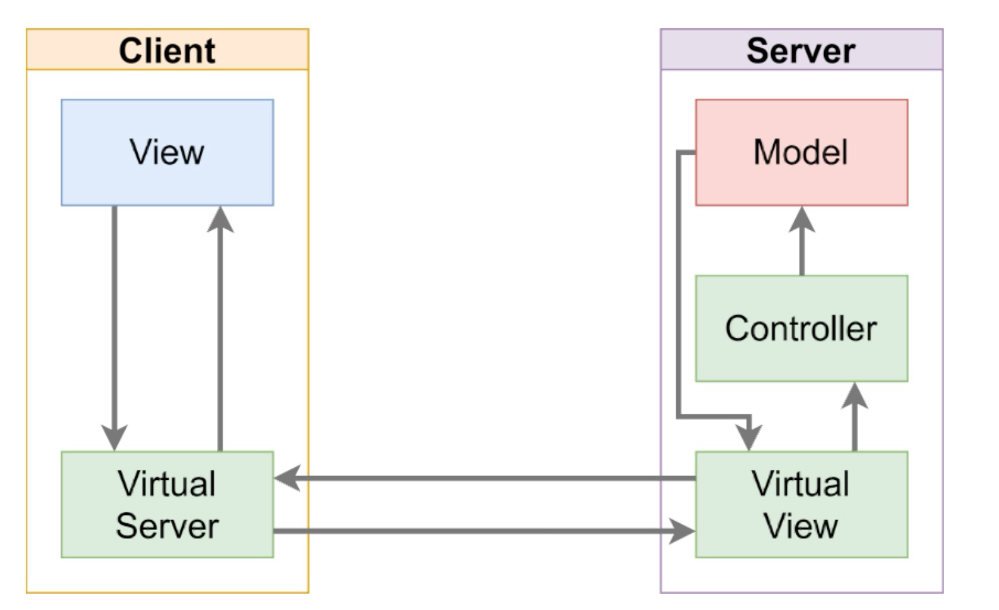

# Mesos Project
Progetto prova finale per l'esame di Ingegneria del Software.
Lo scopo del progetto è quello di implementare il gioco da tavolo mesos in java, in modo da poter
giocare con altri player, ognuno dal proprio device, collegandosi ad un server.
È possibile giocare sia da interfaccia testuale che grafica. La versione qui implementata ha inoltre le seguenti
feature aggiuntive:
- supporto per multi-partita in parallelo sullo stesso server
- persistenza in caso di crash del server, ovvero i client che erano in partita possono riprendere
dall'ultimo stato del gioco prima del crash
- Ranking di tutti i player con salvataggio su database

## Architettura del progetto
In questa sezione viene spiegata l'architettura ad alto livello del progetto, poi nelle relative 
sottosezioni verranno spiegati in dettaglio i particolari implementativi e i pattern applicati.

Il design pattern principale del progetto è quello del  [Model View Controller distribuito](https://github.com/T-vaccari/javafx-distributed-mvc), ovvero una versione del
MVC in cui la view si trova su una altra macchina rispetto al controller e il model, come si può vedere nella seguente immagine:


L'idea è quindi quella di applicare il pattern ma nascondere la presenza delle rete
ai blocchi core del pattern. 


### Design della rete


### Architettura del Client


### Architettura del Server


#### Session Registry 


## Usage
### Avvio PostgreSQL locale
Per sviluppo locale il repository include un `docker-compose.yml` con PostgreSQL.
Il database viene usato per ranking e storico risultati; il salvataggio dello stato match non e'
gestito da PostgreSQL.

1. Avvia il database:
```bash
docker compose up -d postgres
```

2. Configura le variabili ambiente del server. Puoi partire da `.env.server.example`.

Variabili supportate:
- `MESOS_DB_URL`
- `MESOS_DB_ADMIN_URL`
- `MESOS_DB_USER`
- `MESOS_DB_PASSWORD`
- `MESOS_DB_MAX_BUSY_RETRIES`
- `MESOS_NO_DB`

Default locali:
- `jdbc:postgresql://localhost:5432/mesos`
- admin DB `jdbc:postgresql://localhost:5432/postgres`
- utente `postgres`
- password `postgres`

3. Avvia il server:
```bash
MESOS_DB_URL=jdbc:postgresql://localhost:5432/mesos \
MESOS_DB_ADMIN_URL=jdbc:postgresql://localhost:5432/postgres \
MESOS_DB_USER=postgres \
MESOS_DB_PASSWORD=postgres \
./mvnw -q -Dexec.mainClass=it.polimi.ingsoft.mesos.server.LaunchServer exec:java
```

Per avvio naive senza PostgreSQL:
```bash
MESOS_NO_DB=true ./mvnw -q -Dexec.mainClass=it.polimi.ingsoft.mesos.server.LaunchServer exec:java
```

All'avvio il server crea il database se manca, inizializza lo schema ranking, verifica la connettivita' verso PostgreSQL e fallisce con un errore esplicito se il DB e' irraggiungibile o non healthy.
