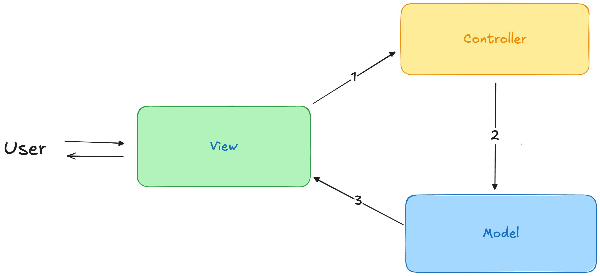
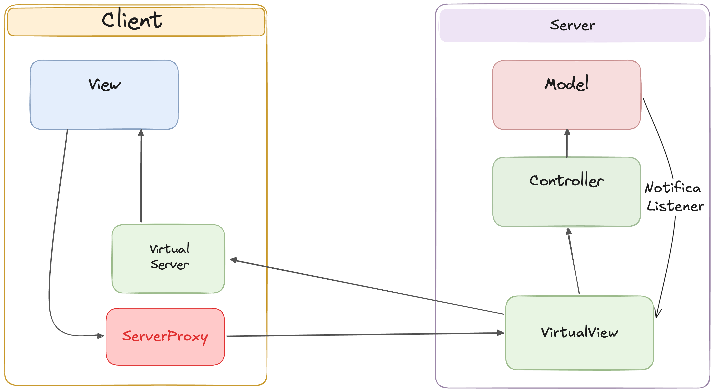
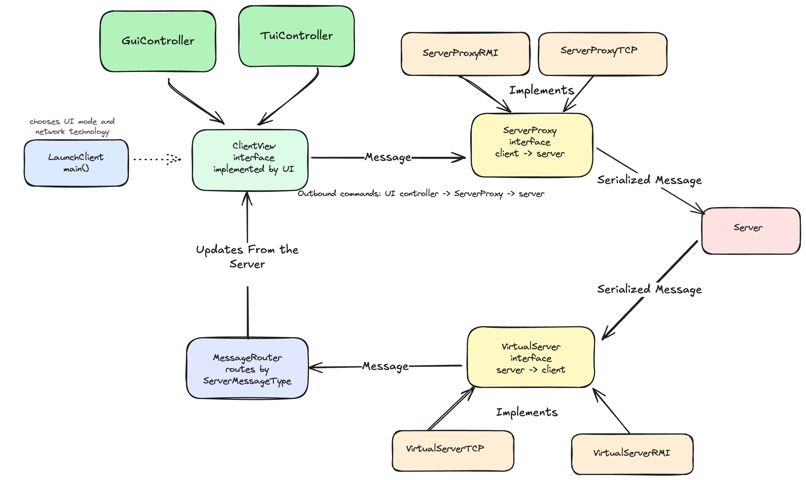

# Mesos 
Progetto prova finale per l'esame di Ingegneria del Software.
Lo scopo del progetto è quello di implementare il gioco da tavolo mesos in java, in modo da poter
giocare con altri player, ognuno dal proprio device, collegandosi a un server.
È possibile giocare sia da interfaccia testuale che grafica. La versione qui implementata ha inoltre le seguenti
feature aggiuntive:
- Supporto partite parallele sullo stesso server
- Resilienza alle disconnessioni da parte dei client

## Configurazione, Compilazione e Avvio

In questa sezione viene spiegato come configurare l'ambiente, compilare il progetto in un archivio JAR ed eseguirlo (sia Server che Client) da riga di comando.

### 1. Trovare l'indirizzo IP locale
Se si desidera giocare in modalità multiplayer su una rete locale (LAN o hotspot), è necessario conoscere l'indirizzo IP del computer su cui gira il Server. Di seguito i comandi per trovarlo a seconda del sistema operativo:

* **macOS**:
  ```bash
  ipconfig getifaddr en0
  ```
  *(Se si è connessi via Wi-Fi; se connessi via cavo o altra interfaccia, verificare con `ifconfig`)*
* **Linux**:
  ```bash
  ip route get 1.1.1.1 | awk '{print $7}'
  ```
  *(In alternativa, eseguire `ip a` o `hostname -I`)*
* **Windows**:
  Eseguire nel prompt dei comandi (cmd) o PowerShell:
  ```cmd
  ipconfig
  ```
  Cercare la voce `Indirizzo IPv4` (es. `192.168.1.XX` o `172.20.10.XX`).

---

### 2. Configurazione di Rete (.env)
Il progetto utilizza due file di configurazione locali nella root del progetto per mappare porte e host:

#### Server (`server.env`)
```env
MESOS_TCP_PORT=12345
MESOS_RMI_PORT=1099
MESOS_SERVER_RMI_HOST=localhost
```
* Se il server deve essere raggiungibile da altri dispositivi nella stessa rete, imposta `MESOS_SERVER_RMI_HOST` con l'IP locale del server trovato al punto 1 (es. `192.168.1.56`).

#### Client (`client.env`)
```env
MESOS_SERVER_HOST=localhost
MESOS_TCP_PORT=12345
MESOS_RMI_PORT=1099
MESOS_CLIENT_RMI_HOST=localhost
```
* `MESOS_SERVER_HOST`: Impostare l'IP del Server (se diverso da `localhost`).
* `MESOS_CLIENT_RMI_HOST`: Impostare l'IP del Client locale (necessario solo per RMI a causa delle callback server-to-client).

---

### 3. Compilazione del progetto
Per compilare il codice ed esportare il file JAR comprensivo di tutte le dipendenze esterne (es. JavaFX, Gson, ControlsFX) necessarie per l'esecuzione, utilizzare Maven wrapper (`mvnw`):

```bash
./mvnw clean package dependency:copy-dependencies -DskipTests
```
*Su Windows (Prompt dei comandi), usare `mvnw.cmd` o `mvn`:*
```cmd
mvnw.cmd clean package dependency:copy-dependencies -DskipTests
```
Questo comando genererà:
* Il JAR principale in `target/mesos-1.0-SNAPSHOT.jar`.
* Tutte le librerie esterne di dipendenza nella cartella `target/dependency/`.

---

### 4. Avvio dell'Applicazione

#### Esecuzione tramite file JAR
Una volta compilato il progetto con successo, è possibile lanciare l'applicazione tramite Java sfruttando i moduli del Java Module System (`--module-path`):

* **Avvio del Server**:
  ```bash
  java --module-path target/mesos-1.0-SNAPSHOT.jar:target/dependency --module it.polimi.ingsoft.mesos/it.polimi.ingsoft.mesos.server.LaunchServer
  ```
* **Avvio del Client**:
  ```bash
  java --module-path target/mesos-1.0-SNAPSHOT.jar:target/dependency --module it.polimi.ingsoft.mesos/it.polimi.ingsoft.mesos.client.LaunchClient
  ```

#### Esecuzione diretta tramite Maven (Sviluppo)
In alternativa, durante la fase di sviluppo, è possibile compilare ed eseguire i moduli al volo senza generare i JAR:

* **Avvio del Server**:
  ```bash
  ./mvnw exec:java -Dexec.mainClass="it.polimi.ingsoft.mesos.server.LaunchServer"
  ```
* **Avvio del Client**:
  ```bash
  ./mvnw exec:java
  ```

---

## Architettura del progetto
In questa sezione viene spiegata l'architettura ad alto livello del progetto, poi nelle relative 
sottosezioni verranno spiegati in dettaglio i pattern applicati e i dettagli implementativi.

Il design pattern principale del progetto è quello del[Model View Controller distribuito](https://github.com/T-vaccari/javafx-distributed-mvc),
ovvero una versione del  MVC in cui la View si trova su una altra macchina rispetto al Controller 
e al Model.

Ricordiamo il pattern MVC classico è un Pattern architetturale che separa il modello dei dati 
di una applicazione(model) dalla
rappresentazione grafica (view) e dalla logica di controllo (controller). 
L'idea è quella di avere la View che si occupa della logica di presentazione delle informazioni
e di raccogliere input dall'utente, il controller invece si occupa 
di coordinare il Model,
per gestire le richieste dell'utente. Infine il Model si occupa di mantenere lo stato e la logica 
di dominio. 
In generale esistono diverse varianti del MVC non distribuito, che hanno alcune differenza su come 
la view interagisce con gli altri due componenti, in particolare qui è stata implementata 
la versione nella quale
la view viene notificata dal Model a seguito di un update, la view non conosce quindi il Model, 
e sotto un certo
punto di vista il Model non conosce la view, poichè viene applicato il pattern observer, ovvero il model
ha riferimenti alla view sotto forma di interfacce listener.
Di seguito uno schema illustrato del pattern:



L'user interagisce con la View, immaginiamo che richieda un servizio, il flusso è il seguente:
1) La view contatta il controller a seguito dell'input utente
2) Il controller fa una prima validazione della richiesta, e sa, in base alla richiesta ricevuta, 
che cosa
richiedere al model. Qui si può fare una prima distinzione tra controller thin e fat, 
a seconda di quanta logica di dominio
viene spostata all'interno del controler. In generale in questa implementazione abbiamo sempre
optato per avere controller thin. 
Il controller dopo aver validato la richiesta, richiede il servizio effettivo al model, che di conseguenza
reagisce e aggiorna il suo stato interno.
3) Dopo che il modello ha modificato il proprio stato interno e ha applicato la logica di dominio, 
deve notificare le relative virtual view.  Possono essercene più di una, dato che più utenti 
possono utilizzare lo stesso modello. Nella nostra applicazione del pattern abbiamo scelto 
di non permettere al modello di conoscere direttamente le view, ma di avere invece iscritti dei listener,
che poi di fatto sono concretizzati dalle virtualview.

L'idea adesso è quella di prendere il pattern classico ed adattarlo ad un contesto nel quale la 
view si trova sulla macchina dell'utente, invece il model ed il controller si trovano sul server. 
E' quindi necessario aggiungere un layer di rete per il trasporto delle informazioni, nascondendo però
ai blocchi del pattern il fatto che di mezzo ci sia la rete. Ovvero per ottenere una architettura il quanto
più pulità possibile la rete deve essere nascosta, non deve essere parte integrante di questo modello.
Per nascondere la presenza della rete sono stati introdotti contratti comuni, che rappresentano 
localmente gli oggetti remoti con cui ciascun lato deve interagire.
Sul client, la user interface non comunica direttamente con la rete, ma usa un `ServerProxy`, 
che rappresenta il server remoto ed espone i servizi applicativi richiedibili dal client. Ovvero 
è stato applicato il remote proxy pattern.
Sempre sul client, il `VirtualServer` rappresenta il canale attraverso cui arrivano 
i messaggi dal server verso l'interfaccia utente locale. Espone infatti i servizi che il server può
richiedere sul client.
Sul server, la `VirtualView` rappresenta invece l'interfaccia utente remota del client: 
riceve i comandi provenienti dal
client e permette al server di notificare aggiornamenti verso quel client. Espone i servizi che 
il client può richiedere al server.
Non è stato introdotto un `ServerProxy` simmetrico lato server, perché il server non deve invocare 
una varietà di
servizi applicativi sul client. In quel verso della comunicazione è sufficiente la `VirtualView`,
che mantiene il
riferimento al client remoto e offre il punto unico attraverso cui inviargli notifiche.

Per chiarire meglio l'architettura può essere utile questo schema illustrato:



## Protocollo di comunicazione
L'implementazione supporta due protocolli di comunicazione, TCP ed RMI.
Per mantenere coerente l'architettura e le funzionalità tra i due protocolli, sono stati definiti contratti comuni 
per la comunicazione tra client e server.

In particolare sono stati fissati i seguenti contratti:
- Servizi che il client espone al server per ricevere messaggi server -> client: interfaccia `VirtualServer`
- Servizi che il server espone al client per ricevere comandi client -> server: interfaccia `VirtualView`
- Messaggi che vengono scambiati via rete tramite questi servizi

Questi contratti derivano direttamente dalla scelta di adottare un MVC distribuito: poiché interfaccia utente, 
controller e model non si trovano nello stesso processo, alcune interazioni
devono necessariamente attraversare la rete.
Per evitare che il protocollo di rete entri nella logica applicativa, tali interazioni sono state espresse 
tramite interfacce comuni.
Ogni implementazione di rete, TCP o RMI, deve quindi offrire gli stessi servizi, 
così da mantenere invariato il comportamento funzionale del sistema indipendentemente dal protocollo scelto.


Gli stessi contratti hanno quindi un doppio ruolo: a livello architetturale realizzano il MVC distribuito, 
mentre a livello implementativo definiscono il comportamento che TCP e RMI
devono offrire in modo equivalente.

Il primo passo è stato quindi fissare i servizi che server e client devono offrire reciprocamente,
in modo da poterli implementare sia con TCP che con RMI.

A livello di codice questo introduce una differenza tecnica tra i due protocolli.
Nel caso TCP le interfacce possono essere normali interfacce Java, usate direttamente dalle classi concrete.
Nel caso RMI, invece, le interfacce remote devono estendere `Remote`, devono essere visibili sia al client 
che al server e i loro metodi devono dichiarare `RemoteException`.

Per questo motivo i contratti logici descritti sopra hanno una controparte specifica per RMI nel package shared:
- `VirtualServer` e `RmiClientService` rappresentano il contratto logico server -> client
- `VirtualView` e `RmiServerService` rappresentano il contratto logico client -> server

Queste interfacce non sono identiche a livello tecnico, ma devono rimanere allineate a livello funzionale: 
ogni servizio disponibile in TCP deve avere il corrispondente servizio anche in
RMI.

RMI richiede inoltre un ulteriore contratto, `RmiConnectionService`, usato dal client per aprire 
la connessione iniziale e ottenere lo stub della propria sessione server-side

### Messaggi e Payload usati dal protocollo
Come già detto per comunicare via rete è stato necessario fissare i contratti dei messaggi scambiati, in modo tale
da poter implementare sia TCP che RMI in modo coerente. In particolare si è cercato di mantenere 
i payload il più possibile
semplici e snelli in modo da ridurre la quantità di dati scambiati e riuscire ad avere 
una gestione semplice sia nella serializzazione JSON con GSON, sia nel passaggio degli oggetti tramite RMI.

Per comodità abbiamo suddiviso in maniera gerarchica i payload rispetto alla fase di gioco a cui fanno riferimento,
ovvero:
- pre-lobby: payload usati per la fase di pre-lobby
- lobby: payload usati per la fase di lobby
- in-game: payload usati per la fase di gioco

Abbiamo inoltre la suddivisione rispetto al senso di comunicazione, ovvero:
- client -> server: payload usati per i messaggi inviati dal client al server(package `clienttoserver`)
- server -> client: payload usati per i messaggi inviati dal server al client(package `servertoclient`)

Nel codice bisogna distinguere tra messaggio e payload.
Il payload contiene i dati applicativi veri e propri: ad esempio il nickname scelto dal client,
l'id della lobby, la carta selezionata o lo stato aggiornato della partita.
Il messaggio invece aggiunge l'informazione necessaria per interpretare quel payload.

Nel caso TCP questa distinzione è esplicita, perché sulla socket arriva solo una stringa JSON:
per questo il payload viene inserito dentro un messaggio wrapper formato da:
- `type`: indica il tipo del messaggio
- `payload`: contiene i dati associati a quel tipo

Nel codice questo wrapper esiste in due varianti, una per ciascuna direzione:
- `ClientMessage`, con un `ClientMessageType` e un payload che implementa `ClientPayload`,
  per i messaggi client -> server
- `ServerMessage`, con un `ServerMessageType` e un payload che implementa `ServerPayload`,
  per i messaggi server -> client

Gli enum `ClientMessageType` e `ServerMessageType` indicano il tipo del messaggio applicativo
e permettono al codice di capire quale payload aspettarsi e quindi quale classe concreta usare
in fase di deserializzazione.

Ad esempio, un comando client -> server ha questa forma logica:
```json
{
  "type": "AUTHENTICATE",
  "payload": {
    "nickname": "tom"
  }
}
```

Il campo `type` è necessario perché il campo `payload` è generico: prima si legge il tipo del messaggio,
poi si sceglie la classe concreta con cui deserializzare il payload.
Nel caso RMI il problema della deserializzazione JSON non esiste, perché gli oggetti vengono passati
direttamente tramite invocazione remota.
Tuttavia vengono riutilizzati gli stessi payload, così TCP e RMI mantengono lo stesso contratto dati
a livello applicativo.

Ora vediamo in dettaglio i payload che vengono usati dal client per comunicare con il server.
Il `ClientMessage` rappresenta il messaggio inviato dal client al server ed è composto da
un `ClientMessageType` e da un payload.
I payload veri e propri implementano invece l'interfaccia `ClientPayload`, che rappresenta il contratto
di base per i dati inviati dal client al server.

`ClientPayload` viene poi specializzato dalle sotto interfacce relative alle varie fasi di comunicazione:
`PreLobbyClientPayload`, `LobbyClientPayload`, `GameClientPayload` e `ConnectionClientPayload`.

Fra i payload che implementano `PreLobbyClientPayload` abbiamo:
- `AuthenticationPayload`, che contiene il nickname scelto dal client
- `CreateLobbyPayload`, che contiene la dimensione scelta per la lobby
- `JoinLobbyPayload`, che contiene l'id della lobby a cui unirsi
- `ListLobbiesPayload`, che non contiene campi e serve solo a richiedere la lista delle lobby

Fra i payload che implementano `LobbyClientPayload` abbiamo:
- `StartLobbyPayload`, usato per richiedere l'avvio della lobby
- `ExitLobbyPayload`, usato per uscire dalla lobby

Fra i payload che implementano `GameClientPayload` abbiamo:
- `MoveTotemPayload`, che contiene la tile su cui spostare il totem
- `ChooseCardPayload`, che contiene l'id della carta scelta
- `ExtraDrawPayload`, che contiene l'id della carta scelta per la pescata extra

Infine, fra i payload di connessione abbiamo `PongPayload`, che implementa `ConnectionClientPayload`
e viene usato per rispondere al ping del server(spiegato in una sezione successiva)

Per quanto riguarda invece i payload che vengono inviati dal server al client, anche qui bisogna distinguere
tra messaggio e payload: `ServerMessage` rappresenta il messaggio inviato dal server al client ed è composto
da un `ServerMessageType` e da un payload.
I payload veri e propri implementano l'interfaccia `ServerPayload`, che rappresenta il contratto di base
per i dati inviati dal server al client.

`ServerPayload` viene poi specializzato dalle sotto interfacce relative alle varie fasi di comunicazione:
`PreLobbyServerPayload`, `LobbyServerPayload`, `GameServerPayload` ed `ErrorServerPayload`.

Fra i payload che implementano `PreLobbyServerPayload` abbiamo:
- `AuthenticationResultPayload`, che contiene il risultato della fase di autenticazione
- `LobbyListPayload`, che contiene la lista delle lobby disponibili tramite oggetti `LobbySummaryPayload`

Fra i payload che implementano `LobbyServerPayload` abbiamo:
- `LobbyUpdatePayload`, che rappresenta un aggiornamento della fase di lobby, ad esempio autenticazione,
  creazione lobby, join, uscita o avvio della partita

Fra i payload che implementano `GameServerPayload` abbiamo:
- `GamePayload`, che rappresenta lo stato della partita inviato al client, contenente stato del gioco,
  era corrente, ordine dei turni, stato del turno, giocatori e board

Fra i payload di errore abbiamo:
- `ErrorPayload`, che contiene codice e messaggio dell'errore

Alcuni payload, come `LobbySummaryPayload`, `BoardPayload`, `PlayerPayload`, `CardPayload`,
`OfferSpacePayload`, `StartingBlockPayload`, `TribePayload`, `TurnOrderPayload` e `TurnStatePayload`,
non sono messaggi principali inviati direttamente,
ma payload di supporto contenuti dentro payload più grandi.

In sintesi, i payload definiscono il contratto dati comune.
TCP li trasporta dentro messaggi JSON con `type` e `payload`, mentre RMI li passa direttamente come oggetti
nelle invocazioni remote.

### Protocollo TCP
TCP è un protocollo di trasporto a basso livello che permette a due processi di comunicare tramite socket.
Una socket rappresenta un endpoint di una comunicazione bidirezionale: ogni endpoint è identificato da un indirizzo IP e da una porta.
Una connessione TCP è quindi identificata dalla coppia di endpoint coinvolti, cioè endpoint client ed endpoint server.

Nel modello client-server, il server apre una `ServerSocket` su una porta e rimane in attesa di connessioni 
tramite `accept()`.
Quando un client si collega creando una `Socket` verso quell'indirizzo e quella porta, il server riceve una 
nuova socket dedicata a quella connessione.
Da quel momento client e server comunicano usando gli stream associati alla socket: un input stream 
per leggere e un output stream per scrivere.

Dal punto di vista delle socket i dati sono uno stream continuo di byte: è quindi responsabilità dell'applicazione 
stabilire come separare un messaggio dal successivo.
Nel nostro caso è stato definito un semplice protocollo applicativo sopra TCP, ogni messaggio viene 
serializzato in JSON e scritto sulla socket come una singola riga di testo.
Dall'altro lato il messaggio viene letto con `readLine()`, quindi una riga corrisponde 
a un messaggio applicativo completo.

La socket è full-duplex: la stessa connessione permette lettura e scrittura in entrambi i versi.
Nel codice, però, la lettura deve restare sempre attiva ed è bloccante; per questo viene eseguita 
in un thread dedicato.

```java
while ((message = reader.readLine()) != null) {
    handleMessage(message);
}
```

La chiamata a `readLine()` rimane in attesa finché non arriva una riga completa.
Se la connessione viene chiusa dall'altro lato, `readLine()` restituisce `null` e il ciclo termina.
Per questo la lettura non può stare nello stesso flusso che gestisce l'interazione dell'utente.

La scrittura, invece, avviene solo quando c'è effettivamente un messaggio da inviare:

```java
writer.println(serializedMessage);
```

Non serve quindi un thread dedicato alla scrittura, il codice scrive sulla socket nel momento in cui deve 
inviare un comando o una notifica.

Sul client, `ServerProxyTCP` apre la socket, gestisce la scrittura dei comandi verso il server e avvia 
un `VirtualServerTCP` in un thread separato per leggere i messaggi provenienti dal server.
Sul server, `ConnectionAcceptor` mantiene aperta la `ServerSocket`, accetta nuove connessioni 
e crea una `VirtualViewTCP` dedicata per ogni client connesso.

Questa scelta riprende il modello di server TCP multi-thread: il thread principale del listener accetta 
nuove connessioni, mentre ogni `VirtualViewTCP` gestisce la comunicazione con uno specifico client.
La `VirtualViewTCP` legge i messaggi in arrivo dal client, li fa deserializzare e 
li inoltra al router applicativo; quando deve inviare un messaggio al client, usa la stessa socket in uscita.
#### GSON
GSON è la libreria usata per trasformare oggetti Java in stringhe JSON e stringhe JSON in oggetti Java.
Nel protocollo TCP questo passaggio è necessario perché sulla socket viaggiano righe di testo sotto 
forma di byte, non oggetti Java.

Quando il client invia un comando, `ServerProxyTCP` crea un `ClientMessage`, composto da:
- `type`: indica il tipo di messaggio, ad esempio `AUTHENTICATE`
- `payload`: contiene i dati necessari per quel messaggio, ad esempio il nickname

Un messaggio client -> server serializzato in JSON ha quindi questa forma:
```json
{
  "type": "AUTHENTICATE",
  "payload": {
    "nickname": "tom"
  }
}
```
O più in generale direttamente dalla classe ServerMessage abbiamo:
```java
public class ServerMessage implements Serializable {
    public final ServerMessageType type;
    public final Object payload;

    public ServerMessage(ServerMessageType type, Object payload) {
        this.type = Objects.requireNonNull(type, "type cannot be null");
        this.payload = payload;
    }
}
```
Quindi ci aspettiamo di poter inferire il payload in arrivo direttamente leggendo il campo type e chiedendo a GSON di 
deserializzare quella data classe.

La serializzazione avviene con:
```java
GSON.toJson(message)
```

La deserializzazione avviene con:
```java
GSON.fromJson(json, ClasseDaCreare.class)
```

Nei punti in cui il codice deve prima capire il tipo del messaggio, il JSON viene letto come `JsonObject`.
Questo permette di leggere prima il campo `type` e poi scegliere la classe corretta del payload:
```java
JsonObject message = GSON.fromJson(line, JsonObject.class);
String type = message.get("type").getAsString();
JsonObject payload = message.getAsJsonObject("payload");
```

Questo è importante perché il campo `payload` nel wrapper `ClientMessage`/`ServerMessage` è generico.
GSON può serializzarlo facilmente, ma quando deve deserializzarlo deve sapere quale classe concreta usare.
Per questo il codice legge prima il `type` e poi associa quel tipo alla classe di payload corretta.


Per RMI invece la situazione è più semplice, poiche il remote method invocation si occupa di tutto il meccanismo di comunicazione, 
è sufficiente implementare le interfacce e registrare gli stub, inoltre RMI gestisce in automatico la serializzazione degli oggetti, 
quindi non è necessario gestire i dettagli di basso livello.
Non serve quindi un ciclo esplicito di lettura sulla socket, perchè la ricezione dei messaggi avviene tramite invocazione
dei metodi remoti esposti dagli stub.

### Protocollo RMI


## Architettura del Client
Ricordiamo che il client deve poter scegliere sia la tipologia di user interface (che può essere di tipo
testuale o grafica) sia la tipologia di protocollo di rete (che può essere TCP o RMI). 
Il punto di avvio del client è la classe `LaunchClient` che si occupa di leggere da riga di comando
prima la scelta della UI e poi la scelta del protocollo di rete, in base a queste scelte istanzia i blocchi necessari 
per poter avviare il client. In particolare a gestire la user interface è un oggetto controller.
Tale oggetto si occupa di gestire le richieste dell'utente e aggiornare la view. 
Il modo in cui vengono mostrate le informazioni dipende dalla 
UI scelta. Di seguito una immagine della architettura del client, che renderà più chiaro il discorso:


I blocchi principali dell'architettura client sono:
- `ClientView`: è l'interfaccia che rappresenta i metodi per modificare la view del client
- `ServerProxy`: è l'interfaccia che rappresenta il proxy per comunicare con il server
- `VirtualServer`: è l'interfaccia che rappresenta il punto di ingresso per i messaggi provenienti dal server
- `MessageRouter`: è la classe che si occupa di instradare i messaggi ricevuti dal server alla view, in base al type del messaggio
Chiaramente non sono tutti gli oggetti che vengono creati, ma sono i principali oggetti per capire come
è stato strutturato il client.

Queste interfacce e classi esistono principalmente per rendere facilmente interscambiabili a livello di logica
il servizio di rete e il servizio di UI. In particolare andando nel dettaglio, il significato delle interfacce è il seguente:
- Lato User Interface indipendentemente che sia testuale o grafica, deve sapere come poter 
comunicare con il server su richiesta dell'utente, indipendentemente che poi il messaggio viaggi 
via TCP o RMI. Per questo è stato creato il contratto `ServerProxy`, che espone i metodi che il client può usare per mandare messaggi
via rete al server.
- Lato rete il server deve sapere come recapitare i messaggi al client, indipendentemente che ci sia TCP o RMI come protocollo,
esiste quindi il contratto `VirtualServer`, che espone i metodi che il server può usare per notificare il client, indipendentemente da come questi messaggi arrivano.
- Lato `VirtualServer`, una volta ricevuto il messaggio bisogna sapere quale metodo chiamare sulla view per poterlo
mostrare all'utente. Poiché ogni messaggio necessita di essere mostrato e gestito in una certa maniera, la logica di scelta del metodo è stata
centralizzata in `MessageRouter`, che in base al tipo di payload sceglie quale metodo del contratto `ClientView` chiamare.
Usato sia da TCP che da RMI.
- Lato `messageRouter` deve poter sapere come chiamare il servizio di update della view per mostrare un dato pacchetto,
indipendentemente dal tipo concreto di UI che si trova dall'altra parte. Per questo motivo sono stati fissati i servizi per poter mostrare
al client un dato messaggio nell'interfaccia `ClientView`. 

Le implementazioni concrete seguono direttamente queste astrazioni:
- `ServerProxyTCP` e `ServerProxyRMI` implementano `ServerProxy`, quindi espongono alla UI gli stessi metodi per comunicare con il server, cambiando solo il protocollo usato.
- `VirtualServerTCP` e `VirtualServerRMI` rappresentano i due modi in cui il client riceve messaggi dal server. Entrambi ricevono un `ServerMessage` e lo passano al `MessageRouter`.
- `TuiView` e `GUIView` implementano `ClientView`, quindi il `MessageRouter` può aggiornare la view senza sapere se l'utente sta usando TUI o GUI.

Quindi riassumendo il flusso dei messaggi è il seguente:
- In uscita: controller UI -> ServerProxy -> server
- In entrata: server -> VirtualServer -> MessageRouter -> ClientView

## Architettura del Server
### Session Registry 


